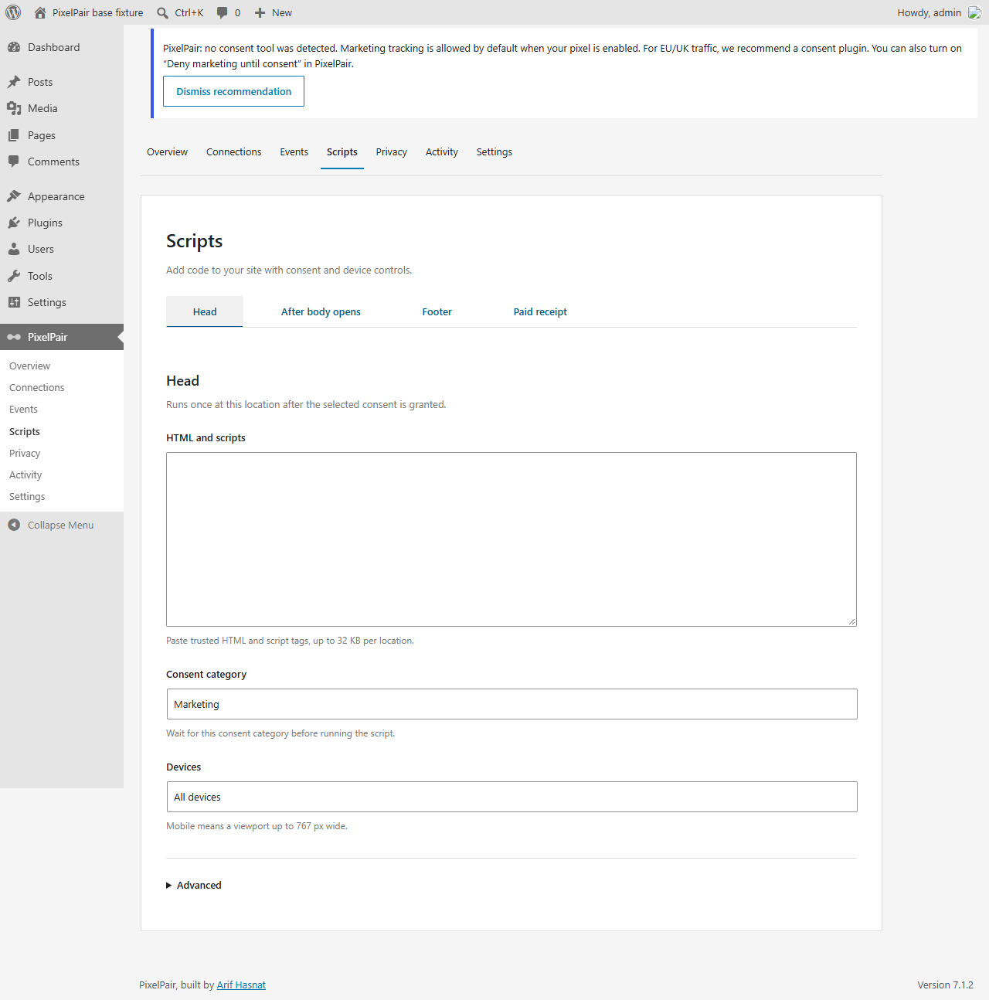

# Activity and scripts

## Inspect server delivery

Open **PixelPair → Activity**. If logging is off, the empty state offers to turn it on. Logging records future server outcomes; it does not recreate past activity.


Filter by connection or status, then expand an entry to inspect its redacted request and response. Tokens and personal matching data are excluded. For a rejected token, open the named connection, replace the token and check again.


The screenshot shows a simulated error on a demonstration site. Server logs report server delivery. They do not prove browser receipt, vendor deduplication or a verified browser/server match. Use the platform dashboard for those checks.

Retention is configurable in Settings. Turn logging off when you no longer need future diagnostic entries.

## Manage scripts

Open **PixelPair → Scripts** to configure the supported Head & Footer slots. Choose the placement, consent category and device target, then save. Required permissions are `manage_pixelpair` and WordPress's `unfiltered_html`; ordinary multisite administrators do not receive `unfiltered_html`.



Only paste code you intend to execute on your site. Scripts run after their selected consent category allows them; already-executed code cannot be undone by consent withdrawal. A third-party script may need its own withdrawal API.

WooCommerce receipt placeholders use JSON literals, for example:

```js
const order = { order_id },
	total = { order_total },
	currency = { currency };
```

Do not add quotes around the placeholders. Receipt values come from an uncached, paid and owner-authorized request. Per-page overrides additionally require permission to edit that page. Purge caches after script changes. Scripts are excluded from import/export and AI access.

See [script integration details](../integrations.md) for execution and receipt limits.
