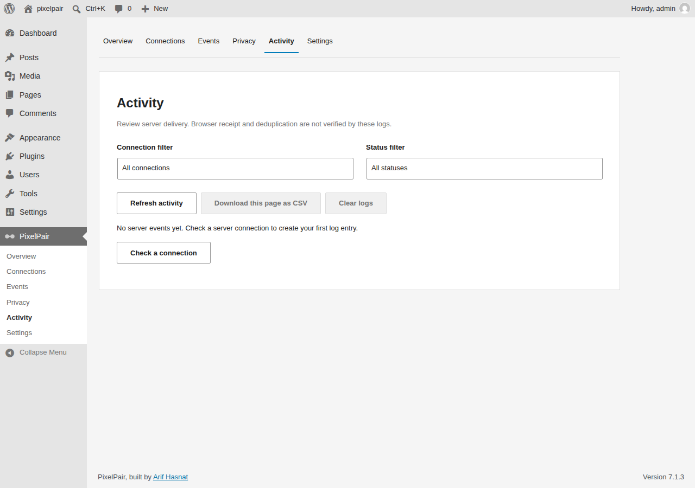
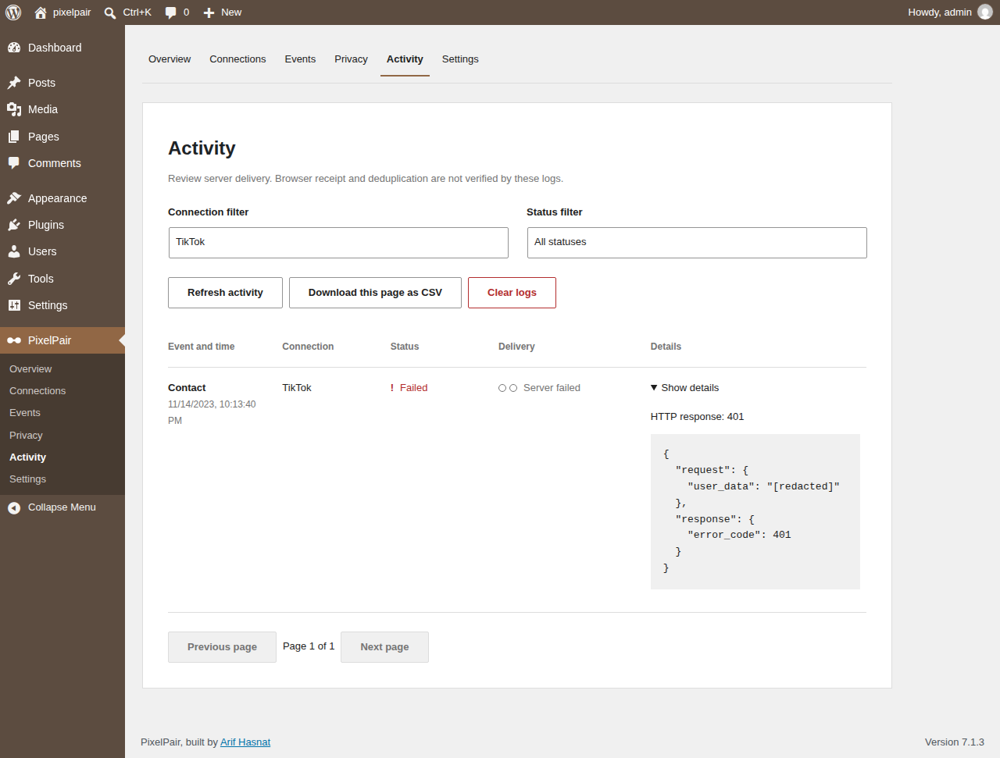

# Activity

Open **PixelPair → Activity** to inspect recent server delivery attempts. Logging must be enabled for new entries to appear. Choose a retention period under **Settings → Advanced**, and keep it only as long as needed for diagnosis.

Filter by platform, status and time range. Expand an entry to inspect the redacted request and response. A failed delivery includes the available platform error; check the connection's ID and token before retrying a test.

Activity reports server delivery attempts. It cannot establish that a browser event arrived or that an advertising platform deduplicated it. Verify those outcomes in the platform's own event manager.

To diagnose missing browser events, follow [Troubleshooting](troubleshooting.md). Arif PixelPair loads each enabled platform through its connection settings; it does not include an arbitrary header or footer script editor.
