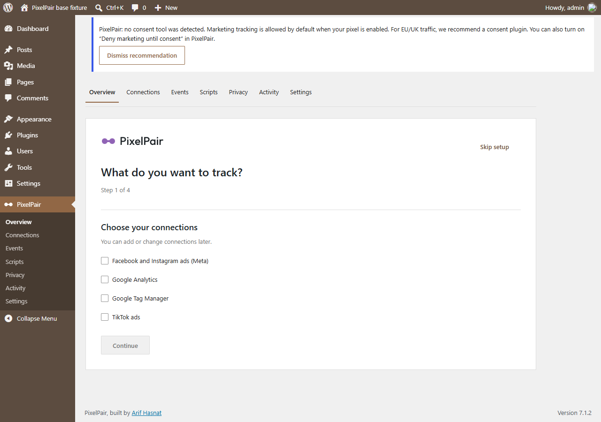
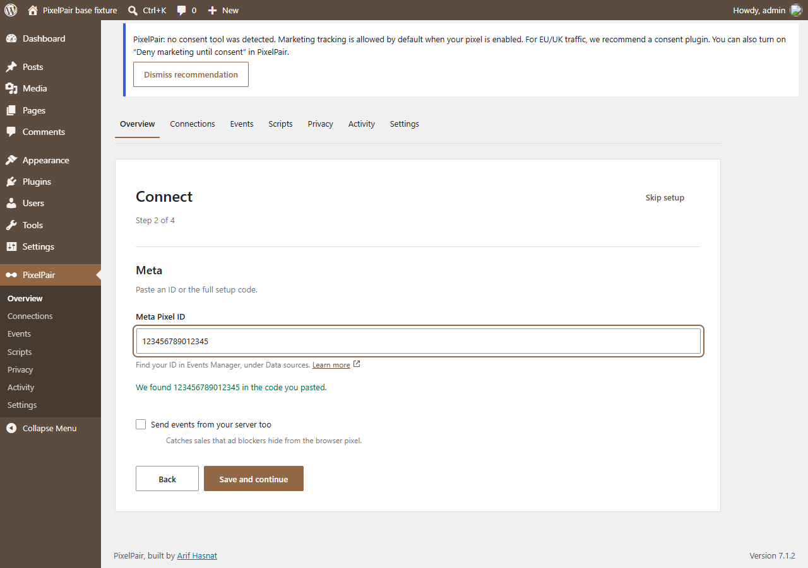
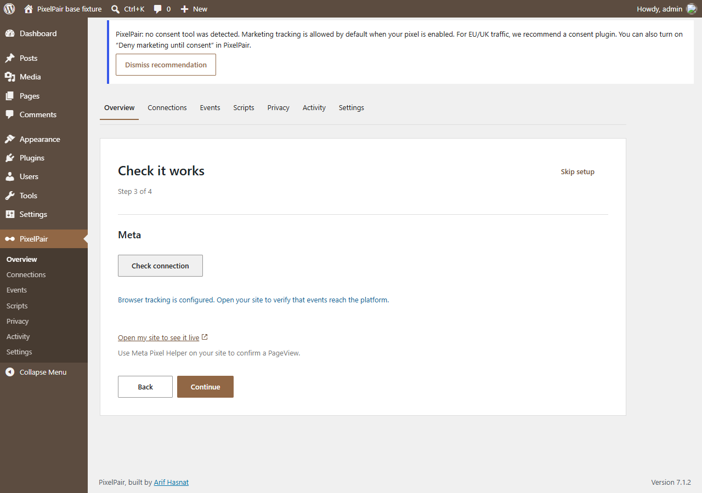
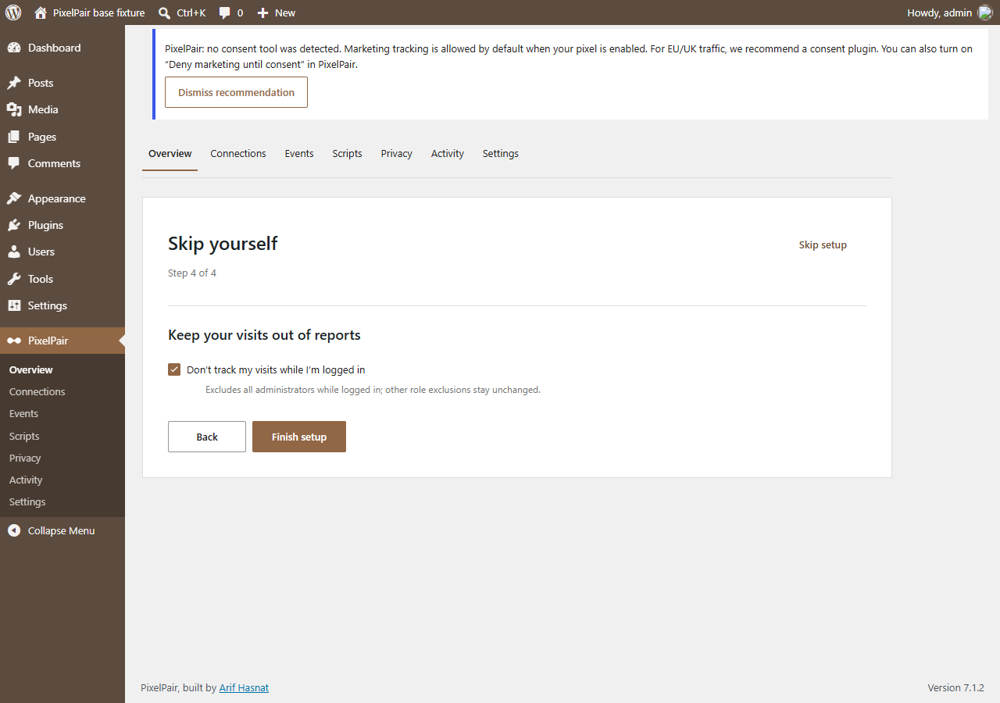
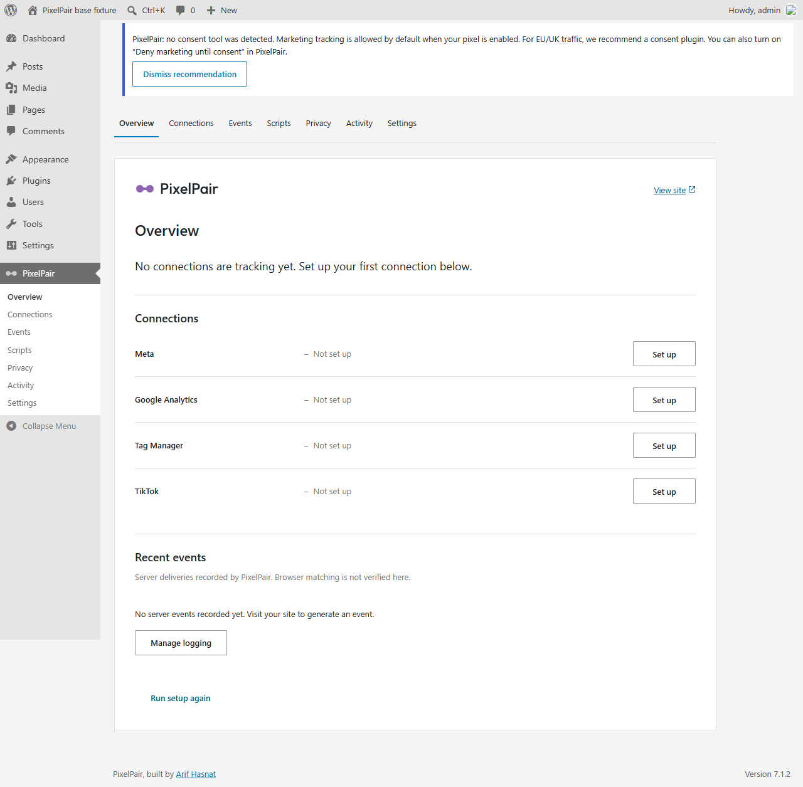

# Install PixelPair and connect Meta

You need WordPress administrator access and your own Meta Pixel ID. Browser tracking can be configured without a server token.

## Install the built plugin

Download **pixelpair.zip** from the [latest release](https://github.com/arifhasnat3po/pixelpair-plugin/releases/latest). Open **Plugins → Add New → Upload Plugin**, choose the file, install and activate it. For an update, choose **Replace current with uploaded**; replacement preserves settings. Do not delete the old installation to update it.

GitHub's automatically generated source archives are for developers. They do not contain compiled administration assets. A normal WordPress installation needs the built release ZIP, not Composer or Node.

## Choose what to track

Open **PixelPair**. On a fresh installation, Overview opens the setup wizard. Select **Facebook and Instagram ads**, then continue. Choose other connections now or add them later. **Skip setup** is always available, and setup can be reopened from Overview.

## Paste your Pixel ID

Paste a Pixel ID or the complete Meta base-code snippet. PixelPair extracts the ID and confirms what it found. It does not execute the pasted snippet. Use the official [Meta setup instructions](https://developers.facebook.com/docs/meta-pixel/get-started/) if you need to locate the ID.

To add server delivery, turn on **Send events from your server too** and enter an access token. This is optional. Tokens are saved separately from ordinary preferences and never returned in full by the settings API.

Select **Save and continue**. If saving settings succeeds but saving a token fails, the message names the partial failure; correct the token and retry.

## Check the connection

Select **Check connection**. A browser-only check validates saved configuration. With server delivery enabled, a saved token and a test event code, the check can send a real server test and show the platform response. Add a test event code in **Connections → Meta → Advanced** if needed.

Open your site in a separate tab and inspect it with Meta Pixel Helper. In Meta Events Manager, confirm the expected data source and event. A successful server check alone does not prove browser receipt or deduplication. See the [verification checklist](../testing-meta.md).

## Exclude your own visits

The final step offers **Don't track my visits while I'm logged in**. When selected, it excludes your current role or roles; it is not a per-person exception. Other people with those roles are also excluded. Finish setup to return to Overview.

If you exclude your role, test browser tracking while signed out or in a private browser window. Review **Privacy** before testing: a detected consent tool must resolve the visitor's choice before tracking starts. Without a detected tool, marketing is allowed by default unless **Wait for marketing consent** is enabled.

## Read your status

Overview gives each connection a status and a next action. **Set up** opens an unconfigured connection, **Manage** opens its preferences, and **Fix** opens a connection with a known problem. A configured connection is not a guarantee of live platform receipt.

Purge your page cache after changing connections, consent tools or exclusions. Add only one integration for the same Pixel ID unless you have deliberately coordinated duplicate tracking.

Next: [Connections](connections.md) · [Privacy and settings](privacy-and-settings.md) · [Troubleshooting](troubleshooting.md)
